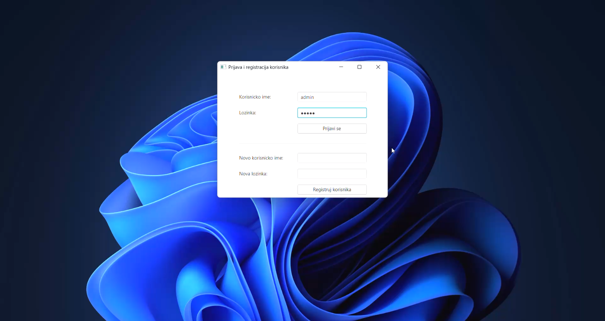
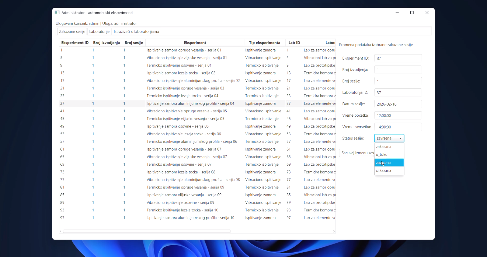
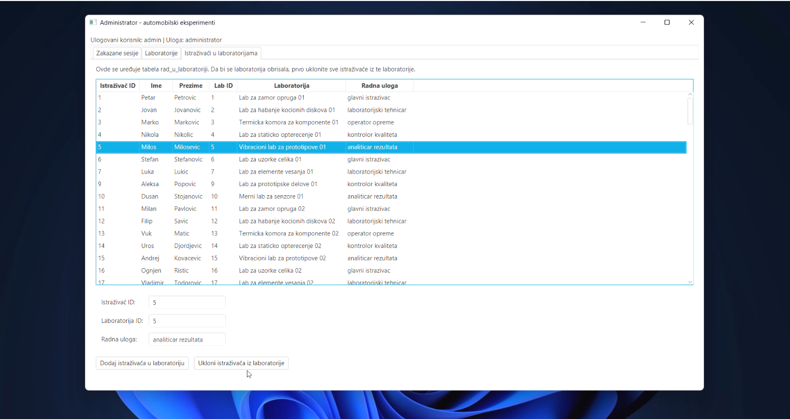

# Automotive Experiments Administration System

JavaFX desktop application connected to a MySQL relational database, developed for managing automotive experiments, laboratories, researchers, and scheduled testing sessions.

## Technologies

- Java
- JavaFX
- MySQL
- SQL
- JDBC
- Maven
- MVC architecture

## Features

- User login and registration
- Viewing scheduled sessions and experiments
- Editing scheduled session data
- Viewing laboratory data
- Managing researcher assignments to laboratories
- Deleting laboratories only when no researchers are assigned to them

## Database

The application uses a relational MySQL database with multiple interconnected entities.

The project includes work with:

- relational database design
- primary and foreign keys
- entity relationships
- SQL queries
- data modification
- database constraints
- data integrity
- Java-to-MySQL integration through JDBC

## Architecture

The application follows the MVC pattern:

- **Model** – DTO classes, repositories, and database access logic
- **View** – JavaFX interface, tables, forms, and dialogs
- **Controller** – user actions, event handling, and communication between the interface and application logic

## Business Logic

One of the implemented rules prevents a laboratory from being deleted while researchers are still assigned to it.

The application also allows administrator users to manage researcher-to-laboratory assignments, which directly affects whether a laboratory can be removed.

## Running the Project

1. Run the provided SQL script in MySQL or phpMyAdmin.

2. Check the `database.cfg` file:

```text
host=localhost
port=3306
db=automobilski_eksperimenti
user=root
password=root
```

3. Default user account:

```text
Username: admin
Password: admin
```

4. Open the project in IntelliJ IDEA as a Maven project and run the `Main` class.

Alternatively:

```bash
mvn javafx:run
```

## Screenshots

### Authentication



### Scheduled Session Management



### Laboratory Management


### Researcher Assignment Management


